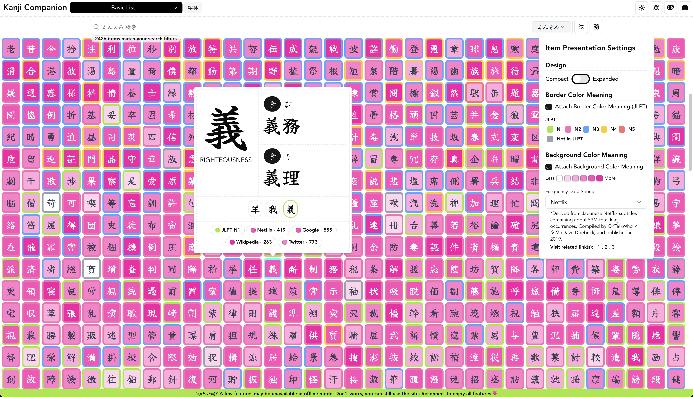
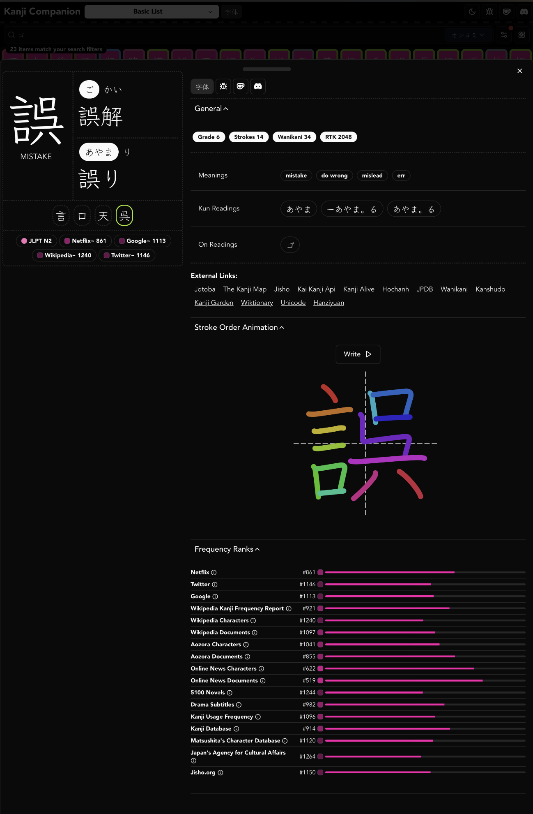
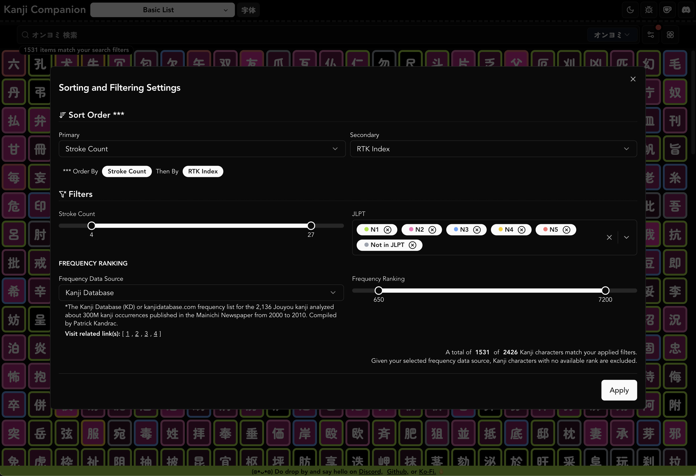

# Kanji Heatmap (previously Kanji Companion)



|  |  |
| :-----------------------------------------------: | :------------------------------------------------: |



## Development

```bash
nvm use 22
pnpm install
pnpm run dev   # http://localhost:5174
```

`pnpm run dev:cf` is the same app on port 5173.

> **Note:** Jisho, Jotoba, KanjiAPI and Google Handwriting lookups go through
> [Cloudflare Pages Functions](./functions/api/) (to get around CORS). Neither
> dev script serves them, so they return 404 locally and only work on the
> deployed site. Everything else works locally.

### Data that isn't in the repo

The per-kanji vocabulary is one file per kanji, so it's gitignored. In
production it comes from cloud storage; locally the vocabulary sections of the
kanji drawer stay empty unless you fill these folders (paths are in
`src/lib/assets-paths.ts`):

- `public/kanji-words/v6/<KANJI>.json`
- `public/kanji-textbook-words-min/<KANJI>.json`

The AI voice files (`public/yomiage/`, ~65 MB) aren't committed either.
`pnpm dev` and `pnpm build` copy them in with
`scripts/copy-yomiage-files.mjs`, downloading them once per yomiage version
into `~/.cache/yomiage`. Offline, a dev server still starts and AI Voice Mode
falls back to the browser voice; a CI build fails instead.

Everything else the app fetches is committed.

## Checks

These are what CI runs (`.github/workflows/ci.yml`):

```bash
pnpm run format:check   # fix with: pnpm exec prettier --write <file>
pnpm run lint
pnpm run typecheck
pnpm test
CF_PAGES=1 pnpm run build
```

`CF_PAGES=1` turns off the Cloudflare Vite plugin, matching the real Cloudflare
Pages build. `pnpm run build` does not run Prettier, so run `format:check`
yourself.

### End-to-end tests (Playwright)

`pnpm install` doesn't download browsers. Install Chromium once, and again
after Playwright upgrades:

```bash
pnpm exec playwright install chromium
pnpm test:e2e
```

To watch or debug a run, add `--headed`, `--debug` or `--ui` to
`pnpm exec playwright test`. If a run fails with
`browserType.launch: Executable doesn't exist`, install Chromium again.

## Kanji data

Every data file the app fetches (`public/json/v2/`, `public/json/katakana/`,
`public/json/fill-the-kanji/`, `public/svg/`) and the Fill the Kanji files in
`src/lib/fill-the-kanji/` (`chunking.json`, `set-sizes.json`,
`set-chunks.json`) are generated by a separate data build and committed here.
Never edit them by hand: a data change is made in the data build, and its
output is copied over these files.

In Fill the Kanji, a batch is cut from the set in file order, so a data change
that inserts or deletes sentences in the middle of a set moves sentences into
different batches, and players' stats stay with the batch numbers, not the
sentences.

### File sizes

```bash
./scripts/print-file-sizes.sh
```

prints raw and gzipped sizes.

## Build analysis

```bash
ANALYZE=true ANALYZE_TEMPLATE=flamegraph pnpm run build
# ANALYZE_TEMPLATE: sunburst, treemap, network, raw-data, list or flamegraph
```

The visualizer settings are in `vite.config.ts`.

### Study engine (optional)

Accounts, sync, notes, bookmarks and review piles come from the private
[experimental-engine](https://github.com/PikaPikaGems/experimental-engine).
Without it the app builds and runs with those features hidden. To include it
locally, build the engine and point at its `dist`:

```bash
KH_STUDY_ENGINE_ENTRY=/path/to/experimental-engine/dist pnpm run dev
```

Deploys get it from `scripts/fetch-study-engine.mjs`, which runs during
`pnpm build` only when the `KH_STUDY_ENGINE_TOKEN` secret (a read-only GitHub
token for that repo) is set, and builds the pinned commit into `.study-engine/`.

## Talk to us

- [Discord](https://discord.gg/Ash8ZrGb4s)
- [X/Twitter](https://x.com/pikapikagemsjp)
- [Instagram](https://www.instagram.com/pikapikagems)
